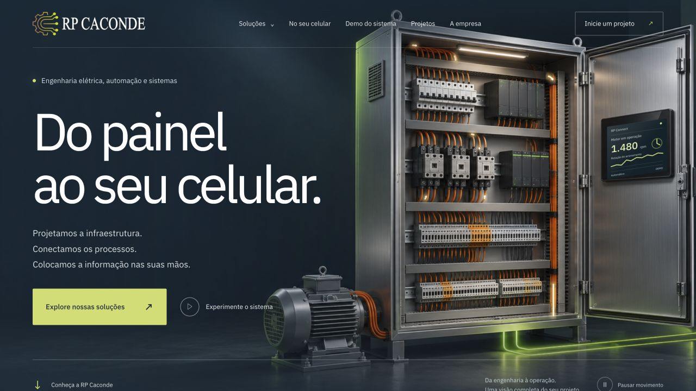

# RP Caconde | Site institucional

Reconstrução institucional com 26 páginas, oito áreas de serviço, portfólio independente, dez projetos detalhados, apresentação da empresa, processo de trabalho, contato e uma prévia interativa de acompanhamento pelo celular. Prévia local com Docker e build separado para publicação na VPS. Site público: https://www.rpcaconde.com.br/.

## Abrir

Com o Docker Desktop em execução, clone o repositório e inicie o site:

```sh
git clone https://github.com/lucaaslimadev/Site-RPC.git
cd Site-RPC
docker compose up -d --build
```

Acesse **http://localhost:8088**. A porta está vinculada somente a `127.0.0.1`. Se você baixou o ZIP do GitHub, extraia os arquivos e execute apenas `docker compose up -d --build` dentro da pasta extraída.

Não é necessário instalar Node.js ou Python para visualizar o site com Docker: as páginas e os arquivos da demonstração já estão prontos em `public/`. Python 3 é utilizado apenas para gerar novamente o HTML após editar o conteúdo; Node.js é utilizado nas verificações de JavaScript e nos testes da demo.

Páginas principais:

- `/`: página inicial institucional.
- `/demo/`: demonstração interativa do RPC Suite, com 12 módulos. Consulte `DEMO.md` para a jornada de exploração e os limites.
- `/servicos/`: catálogo de soluções.
- `/servicos/sistemas/`: software, supervisão, produção e gestão.
- `/servicos/automacao/`: automação de máquinas e processos.
- `/servicos/engenharia-eletrica/`: projetos, dimensionamento e documentação.
- `/servicos/paineis-eletricos/`: painéis, quadros, CCMs e integração.
- `/servicos/laudos/`: inspeções, laudos e diagnósticos.
- `/servicos/retrofit/`: modernização de controles e máquinas.
- `/servicos/manutencao/`: manutenção e suporte.
- `/servicos/treinamentos/`: capacitação da equipe.
- `/operacao-conectada/`: acompanhamento pelo celular e arquitetura de integração.
- `/portfolio/`: trabalhos com filtro por especialidade.
- `/projetos/<identificador>/`: páginas dos dez trabalhos.
- `/empresa/`, `/como-trabalhamos/` e `/contato/`.

## Prévia visual



[Prévia no celular](docs/responsive-preview.png). A direção visual e a origem da arte estão documentadas em `DESIGN.md`. Consulte também [o refinamento do portfólio](docs/refinamento-4.md) e [as novas capas](docs/portfolio-preview.png).

## Parar e retomar

```sh
docker compose stop
```

```sh
docker compose start
```

Para remover os containers e a rede deste projeto, mantendo os arquivos:

```sh
docker compose down
```

## Conteúdo e manutenção

- `build.py`: estrutura e textos das páginas institucionais e geração do HTML.
- `services.json`: conteúdo específico das oito especialidades.
- `public/projects.json`: conteúdo e imagens dos trabalhos.
- `public/style.css`: direção visual e adaptação ao celular.
- `portfolio_views.py` e `public/portfolio.css`: apresentação do portfólio e das galerias.
- `premium_views.py` e `public/premium.css`: composição da página inicial e refinamento visual.
- `project-covers.json`: escolha e enquadramento das capas dos projetos.
- `DESIGN.md` e `HERO-PROMPT.md`: direção visual, arte institucional e prompt final.
- `PORTFOLIO-SOURCES.json`: registro dos textos e 72 arquivos originais, com SHA-256.
- `PORTFOLIO.md`: estrutura, fontes e manutenção dos trabalhos.
- `public/app.js`: menu, filtros, galeria, exemplo interativo e contato.
- `public/assets/`: marca, fontes, imagens institucionais e registros reais.
- `IMAGE-PROMPTS.md`: origem e prompts das imagens geradas.

Depois de modificar textos, serviços ou projetos, gere as páginas novamente:

```sh
python3 build.py
```

Depois, atualize o navegador. Mudanças em CSS, JavaScript e arquivos de imagem aparecem ao recarregar. O diretório `public/` é montado no container, sem necessidade de reconstruir a imagem em cada edição. Mudanças no Dockerfile ou nginx.conf precisam de `docker compose up -d --build`.

### Adicionar um novo trabalho

Acrescente um objeto a `public/projects.json` seguindo o modelo existente. Use um `id` exclusivo, ano em texto, categoria (`automacao`, `sistemas`, `retrofit`, `projetos-eletricos` ou `manutencao`), título, resumo, contexto e entregas. A lista `media` reúne todos os arquivos e é a fonte das galerias: `src`, `width`, `height`, `kind` (`foto`, `interface` ou `projeto`), `caption` e `alt`. A coleção permanece na ordem original. Em `project-covers.json`, defina o índice da capa, o enquadramento, o ajuste (`cover` ou `contain`) e, opcionalmente, o índice de uma segunda foto de detalhe. A galeria abre na capa selecionada, mantendo todos os registros acessíveis. Em `project-stories.json`, inclua o desafio, a solução, a entrega e o índice da foto que acompanha a narrativa. Use somente fatos documentados do trabalho. Guarde os arquivos em `public/assets/portfolio/<pasta-do-trabalho>/`.

Execute `python3 build.py`. O projeto ganha uma página própria e aparece no portfólio na ordem da lista. Para relacioná-lo a uma especialidade, acrescente seu identificador à lista `related` em `services.json`. Consulte `PORTFOLIO.md` para o detalhamento.

Não há painel administrativo nesta etapa. O modelo de conteúdo está separado das páginas e pode alimentar um futuro cadastro com rascunho, revisão e upload de fotos.

## Verificação

Com o container em execução:

```sh
python3 check_site.py
python3 tests/check_portfolio.py
node --check public/app.js
node --test tests/demo-model.test.mjs
```

A verificação cobre páginas geradas, título principal único, IDs, links internos, âncoras e recursos servidos por HTTP. A revisão visual foi realizada no navegador em largura de desktop e em uma prévia de 390 pixels; foram verificados menu, navegação, filtro, galeria com teclado, prévia no celular e preenchimento do serviço na página de contato. Não é uma auditoria integral de acessibilidade.

## Imagens e conteúdo

As fotografias de projetos e o logotipo vieram do site público da RP Caconde. A composição da abertura com painel, motor e conexões e as imagens de indústria, oficina com painel, profissional com tablet e detalhe de terminais são ilustrações institucionais geradas; não representam instalações executadas nem pessoas da equipe. Os créditos no rodapé explicam essa distinção. O portfólio usa registros reais, com acesso aos arquivos completos nas galerias.

Os PNGs originais foram preservados em `public/assets/`; o site carrega versões JPEG mais leves. A tipografia IBM Plex Sans é servida localmente, com licença OFL incluída. Não há necessidade de carregar fontes ou imagens de serviços externos durante a navegação.

A prévia do celular usa dados demonstrativos e não se conecta a equipamentos ou a sistemas da empresa. A disponibilidade real dos módulos e integrações precisa ser definida por projeto. O contato prepara uma mensagem no WhatsApp e depende da revisão e do envio pelo visitante; não armazena os campos neste servidor.

O texto institucional é uma proposta editorial baseada nos serviços públicos da empresa e no escopo informado na conversa. Deve ser revisado pela equipe antes de qualquer publicação futura, especialmente responsabilidade técnica, abrangência de laudos, disponibilidade de suporte e condições de contratação.

## Ambiente

Site estático servido pelo Nginx em Docker. Sem banco de dados, hospedagem externa, coleta de métricas ou publicação em produção. Esta prévia contém `noindex`; o isolamento local é feito pela porta vinculada a `127.0.0.1`.

## Publicação na VPS

A versão pública é gerada separadamente da prévia local. Consulte [deploy/README.md](deploy/README.md) para build, verificação e retorno à versão anterior. A identidade visual atual está documentada em [docs/black-green.md](docs/black-green.md).
